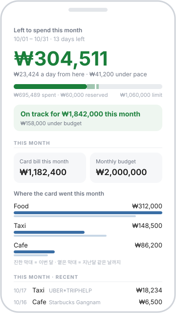
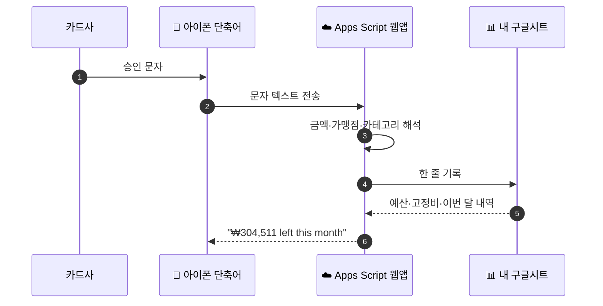
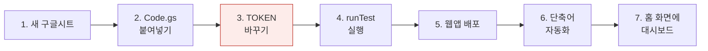
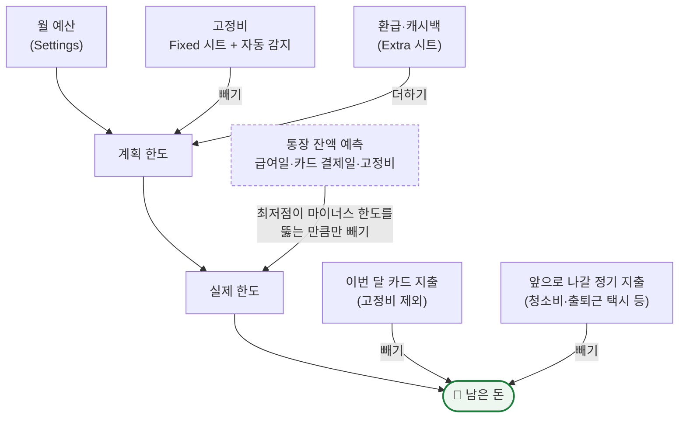
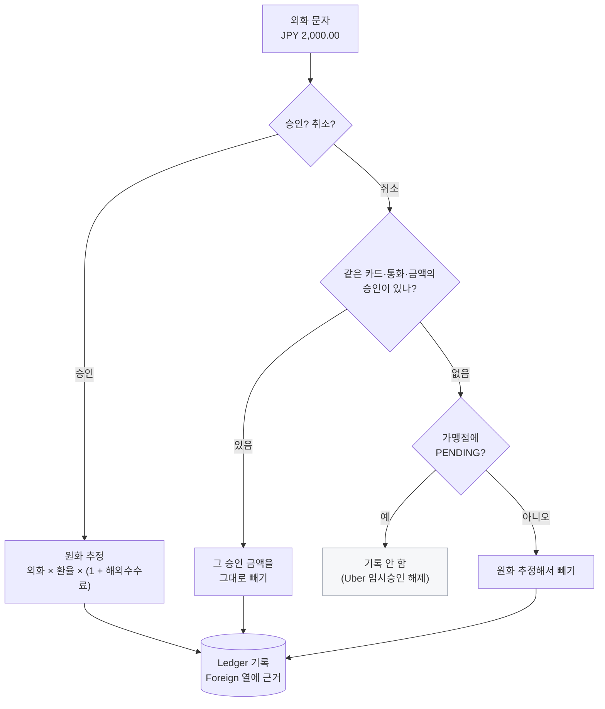
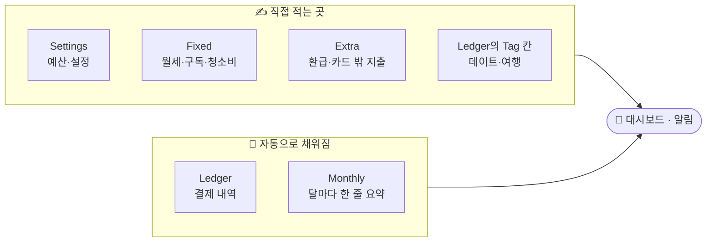
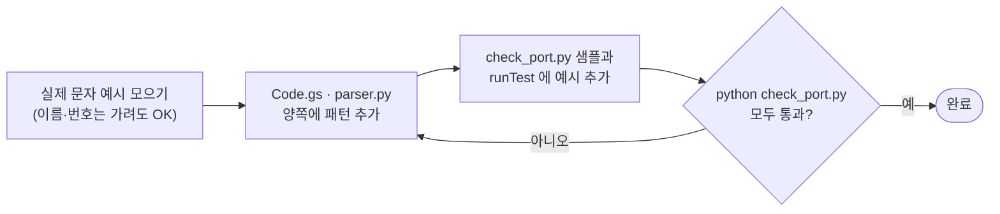

# 💳 카드 문자 가계부

카드 승인 문자가 오면 **알아서 기록하고, 이번 달에 얼마 더 써도 되는지 바로 알려주는** 가계부입니다.
앱 설치·은행 연동·맥 없이 **아이폰 + 구글 계정**만 있으면 됩니다.

<p align="center">
  
</p>

<p align="center"><sub>홈 화면에 추가한 대시보드 (예시 숫자)</sub></p>

---

## 한눈에 보기



| | |
|---|---|
| 🔒 **내 데이터는 내 시트에만** | 외부 서버를 거치지 않고 내 구글 드라이브에만 저장됩니다 |
| ⚡ **문자 받자마자 알림** | PC가 꺼져 있어도 동작합니다 |
| 🌏 **해외결제도 원화로** | 외화 문자를 환율로 환산해 기록합니다 |
| 🧠 **쓸수록 손이 덜 감** | 고친 카테고리·태그를 기억하고, 고정비는 스스로 찾아냅니다 |

---

## 🚀 시작하기 (15분)



1. [sheets.new](https://sheets.new) 로 새 구글시트를 만듭니다.
2. **확장 프로그램 → Apps Script** 에 [`apps_script/Code.gs`](apps_script/Code.gs) 를 통째로 붙여넣습니다.
3. ⚠️ 맨 위 `const TOKEN = 'CHANGE-ME';` 를 **길고 아무 의미 없는 문자열**로 바꿉니다. 가계부의 비밀번호입니다.
4. 함수 목록에서 `runTest` 를 실행해 로그에 `OK` 가 뜨는지 봅니다.
5. **배포 → 새 배포 → 웹 앱** (실행: 나 · 액세스: 모든 사용자) 으로 배포합니다.
6. 아이폰 **단축어 → 자동화** 에서 카드사 문자를 받으면 `…/exec?t=토큰` 으로 보내게 합니다.
7. 같은 주소를 Safari 로 열고 **홈 화면에 추가** 합니다.

> 📖 단계별 자세한 안내는 **[apps_script/설치안내.md](apps_script/설치안내.md)** 에 있습니다.
>
> 💡 코드를 고친 뒤에는 저장만으로 반영되지 않습니다. **배포 → 배포 관리 → 수정 → 새 버전** 으로 재배포하세요.

---

## 📨 지원하는 카드 문자

| 형식 | 예시 |
|---|---|
| 카드번호 괄호형 (신한·우리 등) | `신한카드(1234)승인 홍*동 94,400원(일시불)07/01 19:55 폴리스 유한` |
| 취소 | `신한카드 (1234) 매출취소 홍*동 29,902원 07/12 네이버페이` |
| 카드번호 없는 형식 (현대) | `현대카드Z ontact 승인 홍*동 10,000원 일시불 07/27 17:10 모바일티머니선` |
| 외화 해외결제 (현대) | `현대 대한항공120 해외승인 홍*동님 10/17 16:40 JPY 2,000.00 UBER*TRIPHELP.UBER.COM` |

여러 줄 문자, `[Web발신]` 머리말, `누적…원` 꼬리표는 알아서 정리합니다.
다른 카드사는 [카드사 추가하기](#-카드사-추가하기)를 참고하세요.

---

## 🧮 "남은 돈"은 이렇게 계산합니다



- 점선 칸(통장 잔액)은 `Account balance` 를 적었을 때만 동작합니다. 안 적으면 계획 한도가 곧 실제 한도입니다.
- 고정비는 예산에서 **미리** 뺐으므로 카드로 결제돼도 남은 돈에서 또 빼지 않습니다. 카드값에는 포함됩니다.

---

## 🌏 해외결제는 이렇게 처리합니다



- 환율은 구글시트 `GOOGLEFINANCE` 에서 가져옵니다. 안 되면 `FX fallback` 설정값을 씁니다.
- 실제 청구액은 며칠 뒤 확정되므로, 청구서가 나오면 `Amount` 만 고치면 됩니다.

---

## 📊 시트 구성



시트 상단 메뉴 **Budget** 에서 이번 주 요약 보기 · 월 요약 남기기 · 원장 정리를 할 수 있습니다.

<details>
<summary><b>⚙️ 설정 항목 전체 보기 (<code>Settings</code> 시트)</b></summary>

| 항목 | 기본값 | 설명 |
|---|---|---|
| `Monthly budget` | 2,000,000 | **필수.** 한 달에 쓸 총액 (고정비 포함) |
| `Cycle length (days)` | `Month` | `Month` = 달력 한 달, `7` = 주 단위, 그 밖의 숫자 = N일 주기 |
| `Cycle starts on` | | N일 주기일 때 아무 시작일 하나 |
| `Cycle budget` | 0 | 주기당 쓸 돈을 직접 정할 때. 0 = 위 예산으로 계산 |
| `Week starts on` | `Mon` | 7일 주기의 시작 요일 |
| `Fixed costs (manual)` | 0 | `Fixed` 시트가 비어 있을 때만 쓰는 고정비 합계 |
| `Account balance` | 0 | 지금 통장 잔액 (직접 입력). 0 = 잔액 예측 끔 |
| `Balance as of` | | 잔액을 적은 날. 비우면 오늘 |
| `Overdraft limit` | 0 | 마이너스 통장 한도 (양수) |
| `Monthly income` | 0 | 월급. 잔액 예측과 '이번 달 저금 가능액'에만 씁니다 |
| `Payday` | 25 | 월급날 |
| `Card payment day` | 0 | 카드값 결제일. 0 = 끔 |
| `Overseas fee %` | 1.3 | 외화 결제에 환율 위로 얹는 수수료 |
| `FX fallback` | | 실시간 환율을 못 구할 때 쓸 환율. 예: `JPY=9.1, USD=1380` |

</details>

<details>
<summary><b>🧠 자동으로 알아서 하는 것</b></summary>

| 기능 | 동작 |
|---|---|
| 카테고리 분류 | 가맹점 이름으로 Food·Cafe·Taxi 등 15개로 나눕니다. 한 번 고치면 같은 가맹점은 다음부터 그 값을 따릅니다 |
| 태그 학습 | 같은 가맹점에 같은 태그를 두 번 이상 달면 다음부터 자동으로 붙습니다 |
| 고정비 감지 | 26~35일 간격으로 비슷한 금액(±15%)이 반복되면 고정비로 보고 예산에서 미리 뺍니다. 40일 넘게 안 나오면 풀립니다 |
| 중복 방지 | 같은 문자를 두 번 보내도 한 번만 기록하고 알림으로 알려줍니다 |

</details>

---

## 🔒 보안

> [!WARNING]
> 웹앱은 "링크가 있는 모든 사용자"에게 열려 있고 **`TOKEN` 으로만 막습니다.**
> 반드시 바꾸고, `?t=…` 가 붙은 주소를 다른 사람과 공유하지 마세요.

- 포크해서 공개 저장소에 올릴 거라면 그 전에 `TOKEN` 을 빼세요. 코드에서 지워도 git 이력에는 남습니다.
- 엑셀 파일·문자 원본(`*.xlsx`, `messages.txt`)은 `.gitignore` 로 커밋되지 않습니다.

---

<details>
<summary><b>🐍 파이썬 도구 (선택) — PC에서 엑셀로 정리하기</b></summary>

구글시트 없이 문자 뭉치를 엑셀(`가계부.xlsx`)로 정리할 때 씁니다.

```bash
pip install -r requirements.txt
python run.py messages.txt   # 문자를 붙여넣은 파일을 읽어 저장하고 이번 주 현황 출력
python run.py --week         # 새 문자 없이 이번 주 현황만
python run.py --demo         # 데모 데이터로 체험
```

| 파일 | 역할 |
|---|---|
| `parser.py` | 문자 1건 → 금액·가맹점·날짜·카테고리 |
| `ledger.py` | 엑셀 누적 저장 (중복 방지·정렬·태그 보존) |
| `report.py` | 고정비 감지 + 주간/월간 요약 시트 |
| `run.py` | 위 셋을 묶은 실행기 |

`Fixed`·`Extra` 시트, 잔액 예측, 해외결제 환산은 구글시트(`Code.gs`)에만 있습니다.

</details>

## 🛠 카드사 추가하기

문자 해석 규칙은 `apps_script/Code.gs` 와 `parser.py` **두 곳에 똑같이** 있습니다.



기존 패턴은 `APPROVAL_RE`(카드번호 괄호형), `APPROVAL_NO_NUM_RE`(번호 없는 형식), `FOREIGN_RE`(외화)입니다.

## 💡 탭 없이 완전 자동으로 하려면

아이폰은 앱이 문자를 직접 읽지 못하게 막아서, 단축어 자동화가 사실상 유일한 길입니다.
카드사 알림을 **이메일**로도 받게 설정하면 메일을 읽어 파싱하는 방식으로 완전 무인 자동화가 가능합니다.
